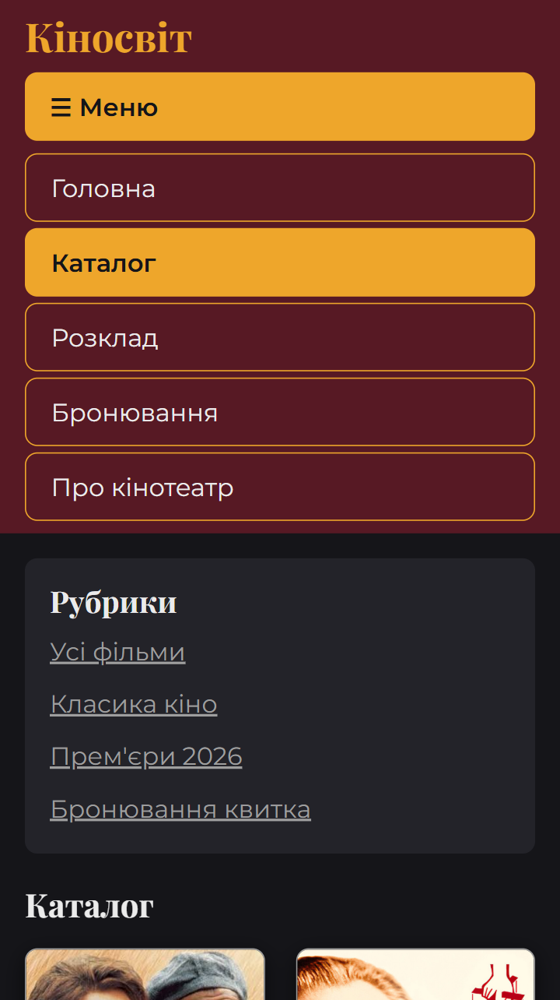
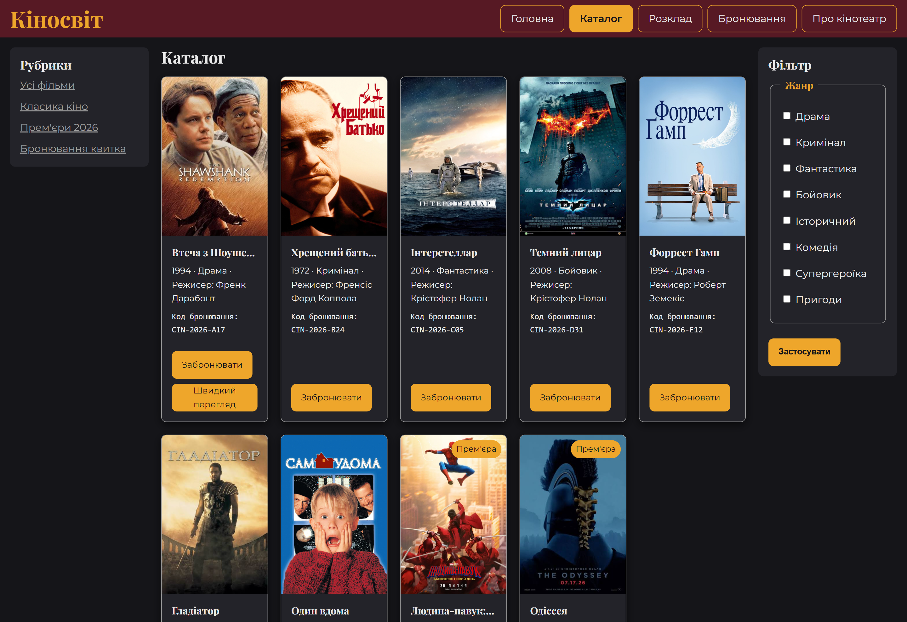

# Кіносвіт — онлайн-кінотеатр (варіант 4)

Навчальний проєкт з веброзробки. Гілка LR7: адаптивний макет і анімації.

## Три розкладки

### Телефон (360px)

Одна колонка: рубрики, каталог, фільтр, футер. Меню складене в кнопку «☰ Меню», у каталозі 2 постери в ряд.

### Планшет (820px)

Дві колонки: каталог і фільтр за жанром, рубрики зверху на всю ширину. Меню розгорнуте в ряд, 3 постери в ряд.

### Десктоп (1440px)

Три колонки: рубрики, каталог, фільтр. Ширина макета обмежена 1440px, 5 постерів у ряд.

## Пороги сітки (виміряно в DevTools)
Ширину міняв у Device Mode з кроком 10–20px і записував, де змінюється кількість постерів у ряду.

| Постерів у ряду | Діапазон ширини вікна |
|---|---|
| 2 | від 230 px до 767 px |
| 3 | від 768 px до 1169 px |
| 4 | від 1170 px до 1339 px |
| 5 | від 1340 px |

Зміна кількості колонок відбувається і між брейкпоінтами 768 і 1024: від 1024px з'являються бічні колонки, які зменшують місце для сітки, тому на десктопі постерів у ряду спершу менше, ніж на 1440px.

## Areas
`grid-template-areas` дає назви зонам макета (nav, main, side, foot), а в CSS ми малюємо схему рядками з цих назв. Кожному блоку розмітки відповідає `grid-area`. Завдяки цьому порядок елементів у HTML залишається один, а схема міняється лише в CSS. У мене це три схеми: на телефоні одна колонка (nav, main, side, foot по черзі), на планшеті `"nav nav" / "main side" / "foot foot"`, на десктопі `"nav main side" / "foot foot foot"`. Коли я міняв місцями слова nav і side у схемі, колонки помінялися без правки HTML. Але є наслідок для доступності: Tab і скрінрідери йдуть за порядком у розмітці, а не за візуальним порядком. Тому схему не можна міняти так, щоб візуальний порядок сильно розходився з порядком у HTML, інакше фокус стрибатиме по сторінці хаотично. Для `index.html` схема окрема, на дві колонки без бічної панелі, бо aside там немає.

## Sticky і Grid
`position: sticky` працює так: елемент рухається разом із прокруткою, доки не дійде до заданого відступу (у мене `top: 0`), а далі "прилипає". Липкий елемент може рухатися лише в межах свого батьківського блока: щойно батько закінчується, елемент їде разом із ним. Якщо б `<header>` лежав усередині `.layout`, сітка відвела б йому один короткий рядок, і їздити було б нікуди: шапка б не липла. Тому `<header>` винесено за межі `.layout`, він прямий нащадок `<body>`. `sticky` відрізняється від `fixed` тим, що sticky лишається в потоці й займає місце, а fixed вилучається з потоку й прибитий до вікна. На телефоні шапку я не роблю липкою: відкрите меню займає пів екрана, і липка шапка закривала б вміст. З 768px, де меню в один рядок, вона липка. Для якірних посилань (#schedule, #about) додано `scroll-padding-top`, щоб липка шапка не закривала заголовок розділу.

## Меню без JS
Меню зроблено на `
` і `
`: браузер сам розгортає й згортає список, працюють Tab, Enter і Space. «Чекбокс-трюк» з `:checked` гірший, бо `<label>` і прихований `<input>` не мають вбудованого значення "кнопка розгортання меню" для клавіатури й скрінрідерів, і для нього треба вручну дбати про фокус. Коли в темі 9 меню зробимо на JavaScript, можна буде закривати його після кліку на пункт, по Esc, змінювати `aria-expanded` і керувати станом без атрибута `open`.

## Що анімуємо
Анімуємо лише `transform`, `opacity`, `box-shadow` і кольори. `transform: translateY(-6px)` дешевший за `top: -6px`: `top` змінює геометрію й змушує браузер заново рахувати розкладку (Layout), перемальовувати (Paint) і складати шари (Composite). `transform` змінює тільки останній етап, Composite, який виконує відеокарта, тому анімація плавна.

## Reduced motion
Рух на екрані може викликати запаморочення й нудоту, особливо у людей із вестибулярними розладами. Блок `prefers-reduced-motion: reduce` не вимикає анімації, а робить їх майже миттєвими (0.01ms), щоб події `animationend` усе одно спрацьовували і кінцеві стани лишалися. Замість руху картка показує золоту рамку. `!important` тут виправданий: це налаштування користувача, воно має перебивати будь-які правила автора незалежно від специфічності.

## Перевірка валідатором W3C
| Сторінка | Errors до | Errors після |
|---|---|---|
| index.html |0 | 0|
| catalog.html |0 |0 |
| form.html |0 |0 |