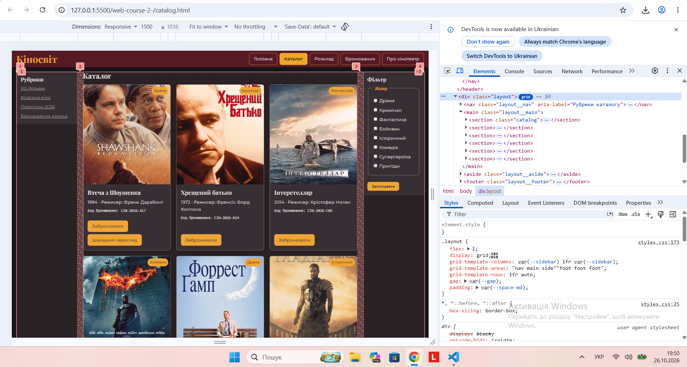

# Кіносвіт — онлайн-кінотеатр (варіант 4)

ЛР6. Макет сторінок на Flexbox і Grid, каталог фільмів, модальне вікно.

## Адаптивна сітка

Каталог зроблено через `display: grid` та
`grid-template-columns: repeat(auto-fit, minmax(240px, 1fr))`.
Кількість колонок підбирається автоматично, медіазапити не потрібні.

Ширина контейнера каталогу менша за вікно: від неї віднімаються дві бічні
колонки (по 220 px), проміжки та поля (разом 512 px). Тому пороги такі
(ширина вікна):
- 4 → 3 колонки: близько 1532 px
- 3 → 2 колонки: близько 1272 px
- 2 → 1 колонка: близько 1012 px

Значення отримані розрахунком: N колонок потребують N × 240 px плюс проміжки
по 20 px, до цього додається 512 px. Перевірено в режимі пристроїв DevTools:
при ширині 1500 px у каталозі 3 колонки.

**auto-fit і auto-fill.** З `auto-fit` порожні колонки схлопуються, і картки
розтягуються на всю ширину. З `auto-fill` порожні колонки залишаються,
тому картки не розтягуються.

## Areas

Макет сторінки задано через `grid-template-areas`: меню, основний вміст,
бічна панель і футер. Якщо поміняти місцями слова `nav` і `side`,
колонки міняються місцями без зміни HTML.

## Sticky і Grid

Шапка має `position: sticky; top: 0; z-index: 10`. Вона стоїть поза `.layout`,
бо липкий елемент рухається лише в межах свого контейнера.

## dialog

Модальне вікно з деталями першого фільму відкривається через `showModal()`,
закривається кнопкою «Закрити» або клавішею Esc. Фон затемнює `::backdrop`,
а сторінка позаду не прокручується (`body:has(dialog[open])`).

## Скріншот

## Валідатор

| Файл         | Errors до | Errors після |
|--------------|-----------|--------------|
| index.html   | 0         | 0            |
| catalog.html | 0         | 0            |
| form.html    | 0         | 0            |