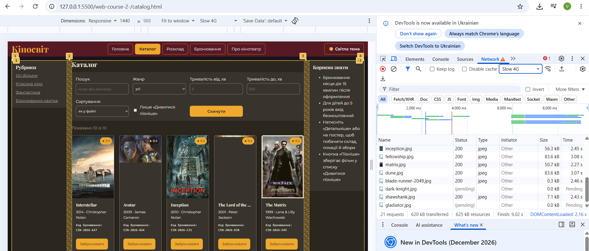
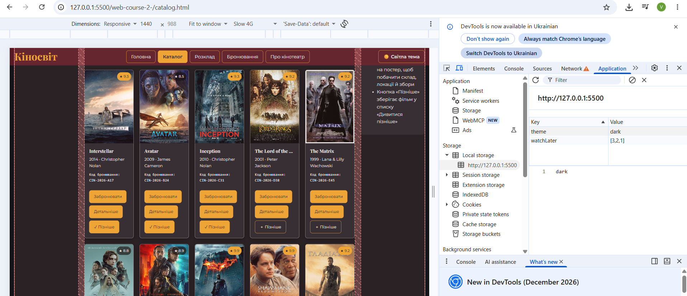

# Кіносвіт — онлайн-кінотеатр (варіант 4)

## Проєкт
«Кіносвіт» — навчальний сайт онлайн-кінотеатру (варіант 4), фінальна робота LR10. Каталог із десяти фільмів завантажується з файла `data.json` через `fetch`. Картки будує JavaScript, є пошук за назвою й режисером, фільтри за жанром і тривалістю, сортування та список «Дивитися пізніше», який зберігається в `localStorage`. Модальне вікно показує склад (актор — роль), локації зйомок і касові збори з обчисленим прибутком. Також працюють форма бронювання з власною валідацією, адаптивне меню й перемикач теми.

## Дані
Дані лежать у `data.json` (файл варіанта 4, не змінювався) і містять 10 фільмів. Запис складається з простих полів (`title`, `year`, `duration_min`, `director`), масиву рядків (`genres`, `locations`), масиву чисел (`ratings`), масиву об'єктів (`cast`: `name`, `role`) і вкладеного об'єкта `boxOffice` (`budget_million`, `gross_worldwide_million`).

«Родзинка» даних: масиви різної довжини (у `ratings` 3–4 елементи, у `locations` від 1 до 5, у `cast` 2–3), а прибутку в даних немає — він обчислюється як збори мінус бюджет і виводиться з розділювачами розрядів через `toLocaleString("uk-UA")`. Порожніх масивів у файлі немає, але код їх обробляє: показує «Склад не вказано» чи «Локації зйомок не вказано». Поля `id` у файлі немає, тому `loadData` додає його в пам'яті (1–10 за порядком у файлі). Постерів у даних теж немає, їх шляхи зберігаються в довіднику `POSTERS`. Секцію «Демонстрація роботи» (`#demo`) і функції LR8 прибрано: вони працювали із зашитим у код масивом, а картки, фільтри й модалка тепер показують ті самі дані краще.

## Завантаження
`loadData` — асинхронна функція: `await fetch("data.json")`, перевірка `response.ok`, `await response.json()` і перевірка, що прийшов непорожній масив. `fetch` не кидає помилку на HTTP 404 чи 500, він повертає відповідь із `ok === false`, тому статус перевіряється вручну: без цього сторінка помилки розбиралася б як JSON і давала б незрозумілу помилку розбору. `init` показує спінер, викликає `loadData` і ловить помилки в `try/catch`. Спінер ховається в `finally`, а не в кінці `try`: після помилки `try` обривається, і спінер лишився б назавжди.

## Що бачить користувач, коли сталася помилка
У блоці з `role="alert"` з'являється повідомлення з порадою («Не вдалося завантажити каталог. Перевірте з'єднання і оновіть сторінку») і технічними подробицями, а спінер зникає. Перевірено три сценарії: 404 (неправильне ім'я файла), Offline (профіль у DevTools) і зіпсований JSON (зайва кома). У кожному видно повідомлення, а спінер сховано. Консоль користувач не відкриває, тому `console.error` у `catch` недостатньо.

## Пам'ять
У `localStorage` лежать лише два ключі: `watchLater` (масив id фільмів зі списку «Дивитися пізніше», збережений через `JSON.stringify`) і `theme` (`"dark"` або `"light"`). Нічого чутливого там немає: ніяких логінів, паролів чи токенів, бо сховище доступне будь-якому скрипту на сторінці. Тема читається зі сховища раніше, ніж із системної схеми: збережений вибір користувача важливіший за налаштування, яке він міг не обирати свідомо. Читання списку захищено від `null` і зіпсованого JSON через `try/catch`.

## Безпека
Дані з `data.json`, поле пошуку й форма потрапляють на сторінку лише через `textContent` або `createElement` + `textContent`. Властивість `innerHTML` у проєкті не використовується: через неї текст з даних міг би стати розміткою й виконати чужий скрипт (XSS). Файл даних сьогодні лежить у репозиторії, а завтра його може віддавати сервер, тому довіряти йому не можна.

Самоатака: у `data.json` я тимчасово замінив назву фільму на ``. Рядок відобразився як текст у картці, у модалці й під час пошуку, вікно `alert` не з'явилося. Після цього дані повернуто у вихідний стан.

## Скріншоти

## Перевірка валідатором W3C
| Сторінка | Errors до | Errors після |
|---|---|---|
| index.html | 0 | 0 |
| catalog.html | 0 | 0 |
| form.html | 0 | 0 |